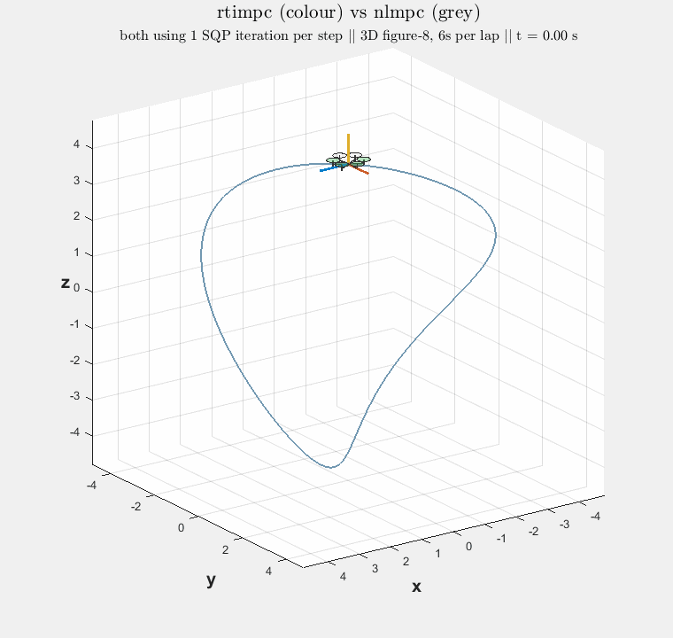

# rtimpc

`rtimpc` is a MATLAB toolbox for nonlinear MPC based on the gold-standard machinery: multiple shooting, **real-time iteration (RTI)**, and a **Riccati IPM** (c.f. HPIPM).

That makes prototyping NMPC more reflective of what'd actually be deployed, and typically much faster to run in MATLAB too. For example, a [trajectory tracking task](#hexacopter) with a hexacopter went from ~3.5 s per step to ~16 ms per step (MATLAB's `nlmpc` vs `rtimpc`).

It also yields fair comparisons between NMPC and other competitor algorithms being prototyped in MATLAB - you have the actual real-time scheme that'd be used, plus MATLAB-based timing (rather than e.g. ACADOS + HPIPM, compiled C, against your MATLAB code's timing 😆).

The code itself is
- fully MATLAB-based; no dependency on compiled functions
- toolbox-free (no need for Optimization / Model Predictive Control Toolboxes etc.)
- developed/validated against a comprehensive set of OCP's, with industry-standard solvers and algorithms (acados, HPIPM, IPOPT, ...) providing the reference solutions.

Compatible with MATLAB R2020b or later.

<a id="banner"></a>
<p align="center">
  <br>
<p align="center">
  A hexacopter tracking a 3D figure-8 with <code>rtimpc</code> (colour) and <code>nlmpc</code> (grey), both at one SQP iteration per step: <code>nlmpc</code> loses control early in the second lap. <br> <sub>Note: copters drawn at 2× scale, playback at 1.25× speed.</sub>
</p>


## Quick start

```matlab
addpath rtimpc rtimpc/qp

nmpc = rtimpc(nx, nu, ny, Ts, N);                  % states, inputs, outputs, sample time, horizon
nmpc.Model.StateFcn     = @(x,u) f(x,u);           % dx/dt
nmpc.Jacobian.StateFcn  = @(x,u) jac_f(x,u);       % [A, B] = df/dx, df/du
nmpc.Model.OutputFcn    = @(x,u) h(x,u);           % y (omit for y = x)
nmpc.Jacobian.OutputFcn = @(x,u) jac_h(x,u);       % C = dh/dx, or [C, D]
nmpc.Weights.Qy = Qy;  nmpc.Weights.Qyf = Qyf;  nmpc.Weights.R = R;
nmpc.Constraints.InputMin = umin;  nmpc.Constraints.InputMax = umax;

nmpc.validate(x_test, u_test);                     % check the derivatives

for k = 1:K
    [u, info] = nmpc.step(x, ref);                 % ref: ny x N, or ny x 1 held
    ...                                            % apply u, measure x
end
```
Examples:
 - see `examples/generic/cartpole_swingup.m` for the simplest complete example: model, Jacobians and their check, a cold start, then real-time iterations. 
 - further examples can be found in `examples/generic` and `examples/mpc_toolbox`, with the latter containing the examples used by MATLAB's MPC Toolbox (note: rebuilt - the same underlying equations and OCPs, but no proprietary code).

## Motivation

MATLAB's `nlmpc` is general, well-developed, and easy to use: it accepts arbitrary nonlinear constraints and costs, integrates with Simulink and code generation, and solves each problem to convergence, using a general-purpose but well-tested nonlinear solver (`fmincon`)<sup>[7](#references)</sup>. But nonlinear MPC is only useful if it can run at control rates, and the standard way to get there consists of:

1. **real-time iteration** (RTI)<sup>[1](#references)</sup>: instead of solving the optimisation to convergence at every sample, take one SQP step (or a few), warm-started from the previous solution.

2. **structure exploitation**: with multiple shooting, the QP at each SQP iteration has the structure of a standard LQ problem, and exploiting that keeps each solve cheap: $O(N)$ in the horizon, versus $O(N^3)$ for a dense general-purpose solver such as `fmincon` in `nlmpc`.

The tools that do offer real-time iteration or structure-exploiting solves are typically either compiled or commercial (e.g. acados<sup>[4](#references)</sup>, HPIPM<sup>[2](#references)</sup>, FORCESPRO<sup>[10](#references)</sup>, and MATMPC, whose core is C compiled via MEX<sup>[6](#references)</sup>).

`rtimpc` provides RTI with HPIPM's Riccati interior-point method<sup>[2](#references)</sup>, in plain MATLAB. That serves two purposes:
- **Realistic speed within MATLAB.** On a tracking problem<sup>†</sup>, the MATLAB-native `nlmpc`, which solves each step to convergence<sup>‡</sup>, required about 3.5 s per step; with `rtimpc` the converged solves reduced to about 340 ms per step, and RTI solves reduced it further to about 16 ms per step, with the latter yielding virtually identical closed-loop performance (see the [comparison](#appendix-comparison-with-nlmpc)).
- **Algorithm comparisons.** `rtimpc` allows for more effective prototyping of NMPC within MATLAB, and fairer comparisons against other algorithms, since the usual methods for achieving real-time NMPC - suboptimal solves, RTI - show up as measurable closed-loop effects, and the timing of `rtimpc` remains reflective of the control algorithm itself, with no speedups underneath from compilation. That last point in particular drove development: the need for an NMPC comparator in MATLAB, reflective of a production real-time implementation, yet with fully MATLAB-based code and timing.

> <sup>†</sup> A hexacopter: an unstable plant with 13 states and 6 tracked outputs, controlled at 20 Hz with a 2 s prediction horizon.

> <sup>‡</sup> `nlmpc` supports iteration caps, but it's not the same thing as RTI. For example, each `fmincon` call restarts its BFGS Hessian, so when iterations are capped it never builds up good curvature information, whereas RTI's Gauss-Newton Hessian is closed-form, accurate from the first iteration, and so a single QP per sample is typically enough.
> 
> The gap between these two similar-seeming SQP approaches is made concrete in the cart-pole comparison herein, see [Comparison with nlmpc](#appendix-comparison-with-nlmpc).

## The optimal control problem (OCP)

`rtimpc` solves the standard nonlinear tracking problem, which is transcribed by multiple shooting.

Let

```math
J = 
\sum_{i=0}^{N-1} \Big( \lVert u_i - u^{\mathrm{ref}}_i \rVert_R^2 + \lVert u_i - u_{i-1} \rVert_{R_\Delta}^2 \Big) +
\sum_{i=1}^{N-1} \lVert h(x_i, u_i) - r_i \rVert_{W_i}^2 +
\lVert h_N(x_N) - r_N \rVert_{W_N}^2
```

At each call, `step(x, ref)` solves

```math
\min_{x,\,u} \ J
\quad \text{such that} \quad
\begin{cases}
x_0 = \hat{x} \\
x_{i+1} = F(x_i, u_i) \\
u_{\min} \le u_i \le u_{\max} \\
\Delta_{\min} \le u_i - u_{i-1} \le \Delta_{\max} \\
c_{\min} \le c(x_i, u_i) \le c_{\max}
\end{cases}
```

and returns the first optimal input, $u_0$.

> See [Method](docs/method.md) for the full description.

## Supported features

You should be able to transcribe most OCPs using the current feature set - please check the examples and the code itself.

If you find something you need is currently unsupported by `rtimpc`, feel free to open an issue and discuss - there's definitely some stuff missing, though what's actually worth adding is an open question.


## Documentation

The main doc [Method](docs/method.md) describes the OCP in more detail, and how it's solved.

Examples ([examples/](examples/)) also serve to illustrate usage and features.

## Verification

`rtimpc` was developed over several months, rigorously checked against reference solvers and results (acados, HPIPM, IPOPT, `quadprog`, `nlmpc`); see [Method, Appendix A](docs/method.md#appendix-a-verification). The full test/verification suite is large and will be published later. For now, you may also check integrity yourself against the `nlmpc`-based examples; they're not just demo's, they were a small-but-core part of the verification suite used during development.

## GenAI Usage

Much of rtimpc was written with generative AI; in the same spirit, contributions are welcome however they were written.

In pull requests, please note any substantial AI contributions. Evidence of correctness always applies (see [Verification](#verification)) and is particularly useful for validating work here.

For documentation: concise, substantive work that has clearly passed through a person's understanding and ownership is gladly welcomed. Otherwise, no docs is preferable (clear slop will be rejected).

> One of Nietzsche's ambitions was to "say in ten sentences what everyone else says in a whole book". In the age of LLMs, such a sentiment has never been more relevant; you can now speak a book (well, "book") into existence - from nothing but a sentence.
>
> Please don't "speak" more than you can own :)

I'm taking a somewhat liberal approach with `v0` in terms of code smells and readability; a functioning, trusted library is the priority for now, and a mildly grey-box approach is an acceptable tradeoff - this is just the cost of not fully authoring a large codebase by hand, and a bit of an experiment in its own right. That doesn't detract from the other criteria however: the library needs to be reliable and useful, so the usual standards apply elsewhere to e.g. code correctness and documentation - solid verification (reproducible evidence of correctness), and solid documentation (quality, with clear human author/ownership).

## Licence

MIT; see [LICENSE](LICENSE).

## References

1. M. Diehl, H. G. Bock, J. P. Schlöder et al., *Real-time optimization and nonlinear model predictive control of processes governed by differential-algebraic equations*, J. Process Control, 2002 (RTI).
2. G. Frison, M. Diehl, *HPIPM: a high-performance quadratic programming framework for model predictive control*, IFAC 2020.
3. C. V. Rao, S. J. Wright, J. B. Rawlings, *Application of interior-point methods to model predictive control*, JOTA, 1998.
4. R. Verschueren et al., *acados — a modular open-source framework for fast embedded optimal control*, Math. Prog. Comp., 2022.
5. J. Nocedal, S. J. Wright, *Numerical Optimization*, 2nd ed., Springer, 2006 (merit functions, line search).
6. Y. Chen, M. Bruschetta, E. Picotti, A. Beghi, *MATMPC — a MATLAB based toolbox for real-time nonlinear model predictive control*, ECC 2019 ([arXiv:1811.08761](https://arxiv.org/abs/1811.08761)).
7. MathWorks, [*Configure Optimization Solver for Nonlinear MPC*](https://www.mathworks.com/help/mpc/ug/configure-optimization-solver-for-nonlinear-mpc.html), Model Predictive Control Toolbox documentation.
8. MathWorks, [*nlmpcmove*](https://www.mathworks.com/help/mpc/ref/nlmpc.nlmpcmove.html), Model Predictive Control Toolbox documentation.
9. MathWorks, [*Hessian Output*](https://www.mathworks.com/help/optim/ug/hessian.html) (quasi-Newton BFGS approximation in `fmincon`'s SQP), Optimization Toolbox documentation.
10. MathWorks, [*Integrate with Embotech FORCESPRO Solvers*](https://www.mathworks.com/help/mpc/ug/integrate-with-embotech-forces-pro-solvers.html), Model Predictive Control Toolbox documentation.

## Appendix: Comparison with `nlmpc`

Here `rtimpc` and MATLAB's `nlmpc` are compared on two of the bundled examples:
- a hexacopter tracking a 3D figure-8 ([`hexacopter_tracking.m`](examples/generic/hexacopter_tracking.m)), and
- a cart-pole swing-up ([`cartpole_swingup.m`](examples/generic/cartpole_swingup.m)).

> Both of these examples are unique in that they can run either `nlmpc` or `rtimpc` on the same problem.
>
> To reproduce these results: in either example, `Controller = 'nlmpc'` runs `nlmpc`, and `SQPIter = 50` solves `rtimpc` to convergence. `nlmpcMaxIter = 1` caps nlmpc to one SQP/iter.

#### Summary

Across both examples:
- **Solved to convergence:** both `nlmpc` and `rtimpc` give the same closed-loop performance, with `rtimpc` 10–40× faster. With a Gauss-Newton Hessian its SQP converges in fewer iterations, and its structure-exploiting QP scales linearly with the horizon (rather than cubically).
- **RTI:** `rtimpc` with RTI closely matches the converged solution, except on the hardest cases, at ~100–200× less per-step compute than converged `nlmpc`.
- **Capped `nlmpc`:** capping `nlmpc`'s iterations does not give RTI. On the hexacopter its closed-loop cost ends up about 3× more, and on the cart-pole it never swings up.

### Hexacopter

A hexacopter tracks a 3D figure-8: $n_x = 13$ states, $n_u = 6$ rotor thrusts (0–16.4 N each), $n_y = 6$ tracked outputs, and a horizon of $N = 40$ (2 s at 20 Hz).

Shorter laps demand more thrust: the table gives the peak thrust the figure-8 itself needs, as a share of the six rotors' total (hover is 50%), and each controller's cost $J$. As the lap time is swept, we get the following:

| Lap time | Thrust demanded | `nlmpc`, solved to convergence | `rtimpc`, solved to convergence | `nlmpc`, capped at 1 iteration<sup>‡</sup> | `rtimpc`, RTI |
|---|---|---|---|---|---|
| 6 s | 81% | 115 | 115 | **320** | 115 |
| 5 s | 100% | 206 | 206 | **571** | 206 |
| 4.5 s | 115% | 292 | 292 | **767** | **389** |
| 4.0 s | 136% | 425 | 425 | loses control | loses control |

> Near the thrust limits, RTI's full SQP step ($\alpha = 1$) overshoots, since it comes from a poor linearisation. With its line search turned on (`Optimisation.RTILineSearch = true`; off by default, as in acados), RTI does not lose control: for about 1-10% more compute, its closed-loop performance closely tracks that of the converged solution, down to a manoeuvre time of about 3.3 s (just short of 3.1 s, which is the limit of the problem itself, i.e. where a converged solve also loses control):
>
> | Lap time | `rtimpc`, solved to convergence | `rtimpc`, 2 SQP iterations per step | `rtimpc`, 1 SQP iteration per step + line search | `rtimpc`, 1 SQP iteration per step (RTI) | `nlmpc`, capped at 1 iteration<sup>‡</sup> |
> |---|---|---|---|---|---|
> | 4.5 s | 292 | 291 | 291 | 389 | 767 |
> | 4.0 s | 425 | 423 | 420 | loses control | loses control |
> | 3.5 s | 738 | 737 | 738 | loses control | loses control |
> | 3.3 s | 1057 | 1085 | 1053 | loses control | loses control |
> | 3.2 s | 1274 | 1273 | loses control | loses control | loses control |
> | 3.1 s | loses control | loses control | loses control | loses control | loses control |
>
> Capped `nlmpc`'s `fmincon` also makes use of a line search after its QP (enabled by default), which helps it degrade gracefully, but it still loses control at 4.1 s and below.

Focussing on the 6 s lap - a relatively benign manoeuvre - we see how 1-iteration-capped `nlmpc` has already diverged from true RTI, with its $J$ score markedly higher, despite RTI itself showing no difference:

| Controller | Per-step compute | Cost $J$ | RMS position error |
|---|---|---|---|
| `nlmpc`, solved to convergence | 3.5 s | 115 | 0.25 m |
| `rtimpc`, solved to convergence | 340 ms | 115 | 0.25 m |
| `nlmpc`, capped at 1 iteration<sup>‡</sup> | 160 ms | 320 | 0.65 m |
| `rtimpc`, RTI | 16 ms | 115 | 0.25 m |

Median per-step compute for both `nlmpc` and `rtimpc` is also given above, with `rtimpc` showing improvement in both cases (RTI, and solving to convergence).

Finally, allowing the runs to *continue over a second lap* shows another gap between the two: with the same 6 s manoeuvre, and the same 1 SQP iteration/step restriction, `nlmpc` loses control, while `rtimpc` continues to track the path steadily (0.26 m RMS error over both laps); [illustrated at the top of the README](#banner).

### Cart-pole swing-up

A cart-pole swings its pole up from hanging: $n_x = 4$ states, $n_u = 1$ force (bounded), $n_y = 2$ tracked outputs, and a horizon of $N = 80$ (4 s at 20 Hz). The track is only ±0.1 m, so the controller has to pump energy into the swing, and the limit is active throughout.

Here, capping nlmpc fails outright: at 1, 3 or 10 iterations, it never swings the pole up. RTI does, at a cost within 2% of the converged solution:

| Controller | Per-step compute | Swing-up | Cost $J$ |
|---|---|---|---|
| `nlmpc`, solved to convergence | 1.1 s | upright at 4.3 s | 18,000 |
| `rtimpc`, solved to convergence | 30 ms | upright at 4.3 s | 18,000 |
| `nlmpc`, capped at 1, 3 or 10 iterations<sup>‡</sup> | 50–270 ms | never | – |
| `rtimpc`, RTI | 12 ms | upright at 4.1 s | 18,400 |
